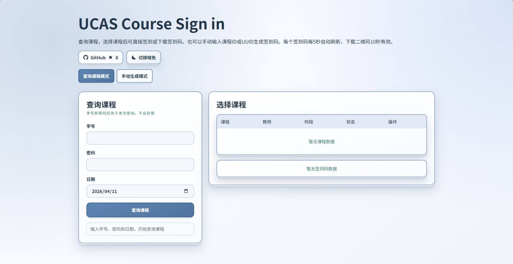
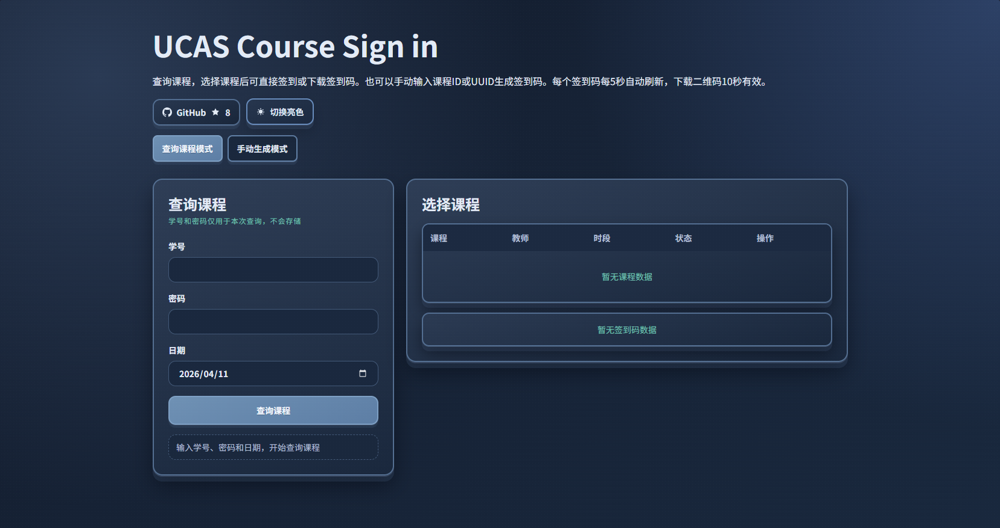
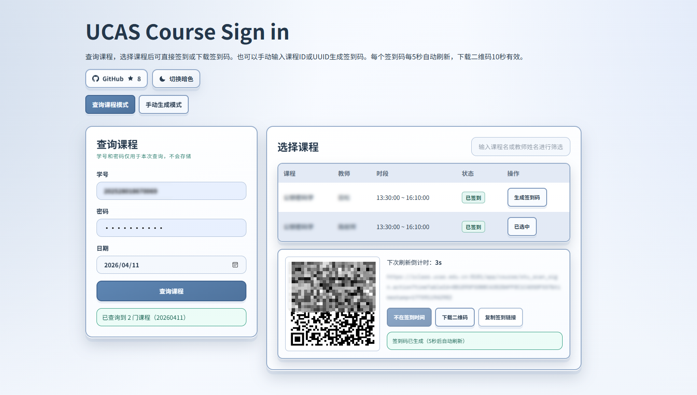

# UCAS Course Sign in

UCAS 课程查询与签到二维码生成工具。

在线访问：[UCAS Course Sign in (Vercel)](https://ucas-sign-in.vercel.app/)

>[!CAUTION]
> **本项目仅供学习交流使用，请勿用于任何商业用途或非法用途。**

本项目用于复现 XXXX 的课程查询与签到链路，帮助用户在网页端完成以下流程：

1. 输入学号、密码和日期，查询当天课程
2. 选择课程，生成可实时刷新的签到二维码
3. 在可签到时间内直接发起签到
4. 手动输入课程 ID 或 UUID，生成对应签到码

## 运行截图







## 快速开始

### 在线访问（推荐）

[UCAS Course Sign in (Vercel)](https://ucas-sign-in.vercel.app/)

### 本地运行

1. 克隆仓库并安装依赖

```bash
git clone https://github.com/lccipher/UCAS-Course-Sign-in
cd UCAS-Course-Sign-in
npm install
```

2. 启动开发环境

```bash
npm run dev
```

默认访问地址：`http://localhost:3000`

3. 生产构建与启动

```bash
npm run build
npm run start
```

4. 代码检查

```bash
npm run lint
```

### 部署上线（可选）

推荐使用 Vercel 进行部署，步骤如下：

1. Fork 本仓库到你的 GitHub 账号
2. 在 Vercel 导入项目
3. Framework 自动识别为 Next.js
4. Build Command 使用默认的 `npm run build`
5. 部署完成后访问生成的域名

## 工作流程

```text
Browser
	-> POST /api/course-uuid/query
		-> login.action (上游登录)
		-> get_stu_course_sched.action (上游课表)
	<- 返回课程列表（已脱敏整理）
Browser
	-> 选择课程 / 手动输入课程 ID 或 UUID
	-> 本地生成签到 URL + QR Code
	-> POST /api/course-uuid/sign（可选，直接签到）
```

说明：

- 上游 `sessionId` 只在服务端请求链路中短暂使用，不回传前端。
- 前端二维码和下载二维码都由本地生成，不依赖额外前端存储。
- 直接签到时，服务端会先登录，再调用上游签到接口。

## 项目结构

```text
.
├─ src/
│  └─ app/
│     ├─ api/
│     │  └─ course-uuid/
│     │     ├─ query/
│     │     │  └─ route.ts      # 登录 + 课表查询接口
│     │     └─ sign/
│     │        └─ route.ts      # 登录 + 直接签到接口
│     ├─ globals.css            # 全局样式与主题变量
│     ├─ layout.tsx             # 字体、元信息、主题初始化
│     └─ page.tsx               # 主页面（查询、列表、二维码、签到）
├─ public/
├─ doc/
├─ package.json
└─ README.md
```

## API 说明

### POST /api/course-uuid/query

查询课程列表。

请求头：

- `Content-Type: application/json`

请求体：

```json
{
	"username": "2025xxxxxxxxxx",
	"password": "your-password",
	"date": "20260325"
}
```

字段说明：

- `username`：学号，必填
- `password`：密码，必填
- `date`：查询日期，支持 `yyyyMMdd` 或 `yyyy-MM-dd`

成功响应示例：

```json
{
	"date": "20260325",
	"total": 2,
	"courses": [
		{
			"id": "114xxxx",
			"uuid": "CADD27F17ACC44EDAFxxxxxxxxxxxxxx",
			"courseName": "xxxxxxx",
			"teacherName": "xxx",
			"weekDay": "周三",
			"classBeginTime": "2026-03-25 10:25:00",
			"classEndTime": "2026-03-25 12:00:00",
			"signStatus": "1"
		}
	]
}
```

常见错误响应：

```json
{
	"message": "登录接口请求超时",
	"code": "UPSTREAM_LOGIN_TIMEOUT"
}
```

### POST /api/course-uuid/sign

发起直接签到。

请求头：

- `Content-Type: application/json`

请求体：

```json
{
	"username": "2025xxxxxxxxxx",
	"password": "your-password",
	"timeTableId": "CADD27F17ACC44EDAFxxxxxxxxxxxxxx"
}
```

字段说明：

- `username`：学号，必填
- `password`：密码，必填
- `timeTableId`：课程 UUID，必填，必须是 32 位十六进制字符串

成功响应示例：

```json
{
	"success": true,
	"message": "签到成功",
	"upstreamStatus": "0",
	"result": {
		"stuSignId": "123456",
		"stuSignStatus": "1"
	}
}
```

可能的失败响应：

```json
{
	"success": false,
	"message": "签到失败，请稍后重试",
	"upstreamStatus": "1",
	"result": {
		"stuSignId": "123456",
		"stuSignStatus": "0"
	}
}
```

## 错误码与排查

### HTTP 状态码

- `400`：请求体或参数格式错误
- `401`：登录失败（账号密码错误或上游鉴权失败）
- `403`：非同源请求
- `409`：签到请求已提交，但状态未完成
- `415`：Content-Type 不是 JSON
- `429`：触发限流
- `502`：上游接口异常或返回异常
- `504`：上游接口超时
- `500`：服务内部异常

### 常见 `code`

- `RATE_LIMITED`
- `UPSTREAM_LOGIN_HTTP`
- `UPSTREAM_LOGIN_BAD_JSON`
- `UPSTREAM_LOGIN_TIMEOUT`
- `UPSTREAM_LOGIN_NETWORK`
- `UPSTREAM_SCHEDULE_HTTP`
- `UPSTREAM_SCHEDULE_BAD_JSON`
- `UPSTREAM_SCHEDULE_TIMEOUT`
- `UPSTREAM_SCHEDULE_NETWORK`
- `UPSTREAM_SIGN_HTTP`
- `UPSTREAM_SIGN_BAD_JSON`
- `UPSTREAM_SIGN_TIMEOUT`
- `UPSTREAM_SIGN_NETWORK`
- `UNEXPECTED_ERROR`

## 技术栈

### 前端

- Next.js 16.2.1（App Router）
- React 19.2.4
- TypeScript 5
- Tailwind CSS 4
- next/font（Noto Sans SC / Noto Serif SC / IBM Plex Mono）

### 服务端

- Next.js Route Handler（Node.js runtime）
- 原生 Fetch + AbortController 超时控制
- 内存级限流（5 分钟窗口 + 每日上限）

### 工具链

- ESLint 9 + eslint-config-next
- qrcode 1.5.4（前端二维码生成）

## License

[AGPL-3.0 License](./LICENSE)

## GitHub Actions 自动课表与签到

项目提供三个 GitHub Actions 工作流：

| 工作流 | 触发方式 | 作用 |
| --- | --- | --- |
| `UCAS 测试获取当前课表并发邮件` | 手动运行 | 立即获取当天课表并发送测试邮件，不修改仓库状态 |
| `UCAS 获取每日课表` | 仅手动运行 | 获取当天课表，保存课表状态，并发送课程表邮件 |
| `UCAS 到点自动签到` | 每节课开始前 25 分钟，也可以手动运行 | 每次先获取当天最新课表，再为签到窗口内的课程尝试签到 |

自动签到按照下表每天触发 13 次，每次实时查询当天课表；没有符合签到窗口的课程时直接跳过。取消清晨预取课表和每 5 分钟轮询。课程是否需要签到以查询结果为准；如果学校调整节次开始时间，需要同步修改 workflow 中的 cron。

| 节次 | 开始时间（北京时间） | 检查并签到时间（北京时间） |
| --- | --- | --- |
| 1 | 08:30 | 08:05 |
| 2 | 09:20 | 08:55 |
| 3 | 10:25 | 10:00 |
| 4 | 11:15 | 10:50 |
| 5 | 13:30 | 13:05 |
| 6 | 14:20 | 13:55 |
| 7 | 15:25 | 15:00 |
| 8 | 16:15 | 15:50 |
| 9 | 17:05 | 16:40 |
| 10 | 18:30 | 18:05 |
| 11 | 19:20 | 18:55 |
| 12 | 20:15 | 19:50 |
| 13 | 21:05 | 20:40 |

GitHub Actions 的定时任务可能延迟，不能保证准点执行；脚本保留上课后 10 分钟的容错窗口，超过窗口则跳过。签到失败后在同一次任务中等待 10 秒加随机 0～10 秒后重试（每轮重新随机），直到成功或窗口结束，不增加额外的定时触发。工作流超时设为 45 分钟，以覆盖最长 35 分钟的签到窗口和收尾步骤。

### 第一步：准备仓库

建议使用 **Private repository**，因为 `.github/state/current.json` 会保存当天的课程名称、教师、时间和签到结果。文件不会保存 UCAS 密码，但课程信息可能属于个人学习信息。

确认仓库已经启用 Actions，并且这些文件已经位于默认分支中：

```text
.github/workflows/ucas-test-schedule.yml
.github/workflows/ucas-fetch-schedule.yml
.github/workflows/ucas-sign-due.yml
scripts/ucas-automation.mjs
scripts/send_mail.py
```

在仓库的 **Settings → Actions → General → Workflow permissions** 中选择：

- `Read and write permissions`
- 如果页面显示 `Allow GitHub Actions to create and approve pull requests`，不需要打开这一项

每日课表和自动签到工作流需要将状态提交回仓库，因此必须有 `contents: write` 权限。测试课表工作流只需要读取代码，使用的是 `contents: read`。

### 第二步：添加 Repository Secrets

进入仓库的 **Settings → Secrets and variables → Actions → New repository secret**，逐个添加下面的 Secrets。名称必须完全一致，大小写也不能改。

| Secret | 是否必填 | 内容 |
| --- | --- | --- |
| `UCAS_USERNAME` | 是 | UCAS 学号 |
| `UCAS_PASSWORD` | 是 | UCAS 密码 |
| `MAIL_HOST` | 是 | SMTP 服务器，例如 `smtp.qq.com`、`smtp.gmail.com` |
| `MAIL_PORT` | 否 | SMTP 端口；465 使用 SSL，587 使用 STARTTLS；不填时默认使用 465 |
| `MAIL_USERNAME` | 是 | SMTP 登录用户名，通常是完整邮箱地址 |
| `MAIL_PASSWORD` | 是 | SMTP 密码或邮箱服务商提供的 SMTP 授权码 |
| `MAIL_TO` | 是 | 收件地址；多个地址使用英文逗号分隔，例如 `a@example.com,b@example.com` |
| `MAIL_FROM` | 否 | 发件人地址；不填时使用 `MAIL_USERNAME` |

账号密码和邮箱密码只填写到 GitHub Secrets 中，不要写到 workflow 文件、README 或提交到仓库。邮箱服务商通常要求使用 SMTP 授权码，而不是网页登录密码。

常见 SMTP 配置示例：

| 邮箱服务商 | `MAIL_HOST` | `MAIL_PORT` |
| --- | --- | --- |
| QQ 邮箱 | `smtp.qq.com` | `465` |
| Gmail | `smtp.gmail.com` | `465` 或 `587` |
| 其他邮箱 | 以服务商 SMTP 设置为准 | 通常是 `465` 或 `587` |

### 第三步：先运行测试工作流

配置完 Secrets 后，先手动测试课表查询和邮件发送：

1. 打开仓库的 **Actions** 页面。
2. 在左侧选择 `UCAS 测试获取当前课表并发邮件`。
3. 点击右侧 **Run workflow**。
4. 选择需要运行的分支，再点击绿色的 **Run workflow**。
5. 打开新生成的运行记录，查看 `Validate required secrets`、`Fetch today's schedule` 和 `Send today's schedule by email` 三个步骤。
6. 确认收件邮箱收到了标题为 `UCAS 测试：今日课程表` 的邮件。

这个测试工作流使用北京时间获取当天课表，不会提交 `.github/state/current.json`，适合先检查 UCAS 账号、网络访问和 SMTP 配置是否正确。当天无课程也会正常完成，并发送包含“今天没有查询到课程”的邮件。脚本兼容空列表、明确的无课提示，以及 `STATUS=1` 且没有错误信息的空结果；登录、网络、明确的上游错误或无法识别的响应仍会报错，避免误报为无课。

### 第四步：启用课前自动签到

测试邮件成功后，`UCAS 到点自动签到` 会在上表列出的时间自动运行：

- 每次先查询当天最新课表，保存到 `.github/state/current.json`，并保留当天已有的签到尝试记录。
- 查询成功后立即检查签到窗口：从课程开始前 25 分钟至上课后 10 分钟。查询失败时本次任务失败，不使用旧课表继续签到。
- 签到失败（包括登录、时间戳或签到接口异常）后，等待 10 秒加随机 0～10 秒后重新登录、获取时间戳并再次尝试；不设固定重试次数上限，直到成功或上课后 10 分钟窗口结束。
- 每次尝试立即更新本地状态文件，记录累计次数和结果；流程结束后由工作流提交回仓库。历史失败记录不会阻止窗口内再次尝试，成功记录或课表显示已签到的课程会跳过。
- 每门课成功后立即停止重试，其他未成功课程继续尝试。窗口结束仍未成功的课程标记为 `expired`，邮件报告最终结果、尝试次数和最后的失败原因。
- 本次重试流程结束后统一发送签到结果邮件；没有符合窗口的课程时不发送邮件，也不会每个节次都发送整天课表。
- `UCAS 获取每日课表` 改为仅手动运行，需要整天课表邮件时可自行触发。

如需立即检查，可在 **Actions → UCAS 到点自动签到 → Run workflow** 手动运行；它同样会先刷新课表，再尝试签到窗口内的课程。

### 本地配置和测试

本地运行时可以使用被 `.gitignore` 忽略的账号文件：

```bash
cp config/credentials.example.json config/credentials.json
# 编辑 config/credentials.json，填写 username 和 password
node scripts/ucas-automation.mjs fetch-schedule
node scripts/ucas-automation.mjs sign-due
```

`config/credentials.json` 只用于本地运行，不能提交到 GitHub。GitHub Actions 始终通过 Repository Secrets 获取账号和 SMTP 配置。

如果仓库此前曾经提交过 Makefile 中的明文账号密码，应立即修改该账号密码；当前 Makefile 已经删除明文输出。

自动化重试测试（使用模拟接口与虚拟时钟，不会真实签到或发送邮件）：

```bash
npm run test:automation
```

本地可通过 `SIGN_RETRY_INTERVAL_MS` 调整失败后的基础等待时间，默认 `10000`（10 秒）；每轮额外叠加随机 0～10 秒（含两端、整数秒），默认总等待时间为 10～20 秒。接近签到窗口结束时，等待会缩短至窗口截止，随后停止尝试。
